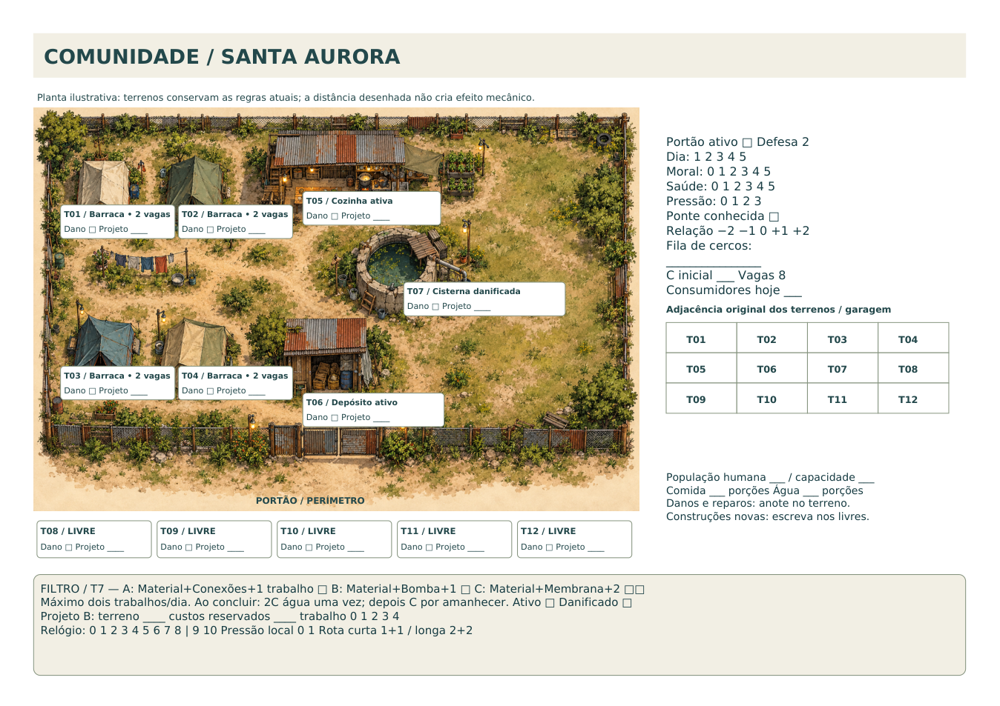
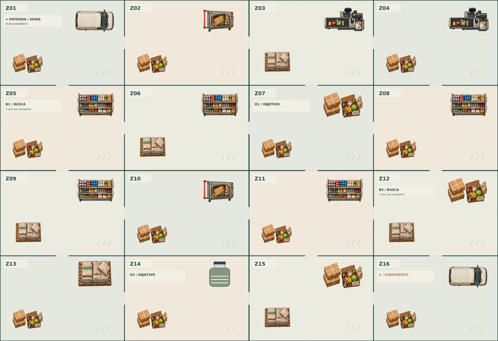

> Prova artística atual: [Posto de combustível em quatro A4](samples/kit-pos-apocaliptico/lote-08-posto/POSTO_4_A4.pdf), [comparação](samples/kit-pos-apocaliptico/lote-08-posto/COMPARACAO_B_ANTES_DEPOIS.jpg) e [relatório](samples/kit-pos-apocaliptico/lote-08-posto/RELATORIO.md). Esta prova não substitui automaticamente o kit distribuído.

# Lote 07 — moradores nas cartas

[Retratos revisados nas oito cartas de moradores](samples/kit-pos-apocaliptico/lote-07-moradores/RELATORIO.md). Seleção preservada; 75/114 IDs com arte nova acumulada.

---

# Lote 06 — itens e cartas

[Oito itens adicionais nas cartas existentes](samples/kit-pos-apocaliptico/lote-06-itens/RELATORIO.md): 29 IDs com arte nova, 67/114 acumulados; PDFs duplex e alternativa manual.

---

## Prova nova — estação de tratamento

[Quatro A4 e comparação com a edição anterior](samples/kit-pos-apocaliptico/lote-05-estacao/RELATORIO.md). Fonte e resolução documentadas; mapa anterior e demais componentes preservados.

> Continuação das provas pós-apocalípticas: [PDFs, comparações e pendências](samples/kit-pos-apocaliptico/LOTES_02_04.md). Hospital/oficina contínuos, 18 retratos restantes, 24 peões e 38 cartas com nova arte. Kit completo ainda em revisão; edições anteriores preservadas.

> Provas locais de direção pós-apocalíptica: [samples/kit-pos-apocaliptico/README.md](samples/kit-pos-apocaliptico/README.md). Seis retratos, nove cartas, inimigos preservados, oficina e hospital. Trabalho parcial; edição distribuída intacta.

# Tabuleiros 0.6 / atualização sem reimprimir cartas

[Downloads 0.6](DOWNLOADS_0.6.md): mapas avulsos para quem já tem a 0.5, kits completos de 58/72 folhas, duas edições, fontes e provas. Cartas, personagens, peões, painel e abrigo preservados. Imprima quatro módulos comuns OU quatro de um destino. [Relatório visual](VISUAL_QA.md).

# Acabamento 0.5 / arquivos para imprimir

[Downloads 0.5](DOWNLOADS_0.5.md): ilustrada e econômica, mesmas 58 folhas duplex ou 72 para colar. Cartas com arte nativa, painel de campo opcional e tabuleiros contínuos com piso vetorial e mobiliário acima de 200 ppi medidos. Personagens, regras e campanha preservados. [Relatório visual](VISUAL_QA.md). Edições anteriores abaixo permanecem disponíveis.

# Fabricação 0.4 / arquivos para imprimir

[Abra o índice de downloads](DOWNLOADS_0.4.md). Edição ilustrada e econômica; escolha duplex (58 A4: 25 + 33) ou recortar/colar (72 A4: 33 + 39). Peões e painéis ampliados são opcionais. Regras, campanha, personagens e edições anteriores preservados. [Relatório visual](VISUAL_QA.md).

# Edição ilustrada 0.3 — Comece Aqui / Duas Pessoas

**Mesmo jogo e personagens da edição 0.2. Apenas apresentação artística e produção gráfica.** Base preservada: 9c38aa5 (posterior a b407e84). Branch `arte/pnp-edicao-ilustrada-v0-3`; sem merge na branch anterior.

- [Baixar ZIP ilustrado — 58 folhas](https://raw.githubusercontent.com/bugijo/Jogo-cartas/arte/pnp-edicao-ilustrada-v0-3/dist/Zona-Zero-0.3-ilustrada-58-folhas.zip)
- [Baixar ZIP econômico — 58 folhas](https://raw.githubusercontent.com/bugijo/Jogo-cartas/arte/pnp-edicao-ilustrada-v0-3/dist/Zona-Zero-0.3-economica-58-folhas.zip)
- [Extras opcionais](https://raw.githubusercontent.com/bugijo/Jogo-cartas/arte/pnp-edicao-ilustrada-v0-3/dist/Zona-Zero-0.3-extras-opcionais.zip) · [Fontes editáveis](https://raw.githubusercontent.com/bugijo/Jogo-cartas/arte/pnp-edicao-ilustrada-v0-3/dist/Zona-Zero-0.3-fontes-editaveis.zip) · [Provas e comparações](https://raw.githubusercontent.com/bugijo/Jogo-cartas/arte/pnp-edicao-ilustrada-v0-3/dist/Zona-Zero-0.3-conferencia-visual.zip)
- [O que imprimir — ilustrada](output/edicao-ilustrada-v0.3/ilustrada/IMPRIMA-ESTES.md)
- [O que imprimir — econômica](output/edicao-ilustrada-v0.3/economica/IMPRIMA-ESTES.md)
- [Guia inicial PDF](output/edicao-ilustrada-v0.3/ilustrada/01_inicial/01_comece_aqui.pdf)
- [PDFs iniciais](output/edicao-ilustrada-v0.3/ilustrada/01_inicial) · [PDFs de complemento](output/edicao-ilustrada-v0.3/ilustrada/02_complemento)
- [Verificação e limitações](VISUAL_QA.md) · [Inventário real](ASSET_MANIFEST.md) · [Comparações antes/depois](output/edicao-ilustrada-v0.3/evidencias)

Escolha ilustrada **ou** econômica: ambas têm **25 folhas iniciais + 33 de complemento = 58 A4**, 114 cartas, 14 fichas selecionadas e 57 marcadores. Sem cartas ou regras novas. Imprima a calibração primeiro. Os PDFs mantêm texto pesquisável e fontes incorporadas. Só cartas e calibração são duplex, retrato, borda longa; demais arquivos são uma face. 100%, sem ajustar.

As seis montagens mostram o ambiente de cada destino; os quatro módulos comuns são reutilizados. Mapas temáticos em `extras/` são opcionais (quatro folhas por destino; 24 para todos), substituindo os módulos comuns. As 24 fichas existentes também estão num extra de 12 folhas. Nenhum extra é necessário ao kit de duas pessoas. ZIPs de impressão básica não incluem esses extras.





## Fontes e reprodução

Reutiliza `requirements.txt`, Python e fontes DejaVu já definidos abaixo. Não precisa gerar imagens novamente, usar chave de API ou acessar um serviço pago.

```bash
python src/build_illustrated.py --cycle 5
python src/document_illustrated.py
python src/export_vectors.py
python src/validate_illustrated.py
python src/visual_qa.py
python src/package_illustrated.py
```

`src/build_illustrated.py` lê catálogo e seleção atuais sem alterá-los; `src/illustrated_art.py` separa ambiente, geometria e sinais. Manuais/guia preservam o texto 0.2. Não execute os geradores antigos para atualizar esta edição; eles continuam disponíveis para reproduzir a anterior. Os pacotes antigos foram mantidos.

Sem impressão física ou playtest humano. Resolução original dos retratos foi mantida: não se alega detalhe novo por ampliação. Veja as limitações no inventário.

---

## Registro preservado da edição 0.2

# Entrega atual — Comece Aqui / Duas Pessoas, edição 0.2

[Abra o índice do kit](output/comece-aqui-duas-pessoas/LEIA-ME.md): 25 folhas para começar o dia 1; 33 de complemento; 58 no capítulo completo. [Guia inicial PDF](output/comece-aqui-duas-pessoas/01_inicial/01_comece_aqui.pdf). [Correções e revisão dos cinco dias](REVISAO_0.2.md). [Profissões consolidadas](PROFISSOES.md).

O estado de partida era db67f42, sem alterações posteriores. A base está na tag preservado/prototipo-0.1-db67f42. A revisão continua o mesmo projeto, com os mesmos IDs e arte; novos PDFs estão em subpastas próprias. Não misture versões.

---

## Registro preservado da entrega 0.1

Os links e números abaixo documentam o pacote anterior. Para imprimir agora, use o índice 0.2 acima.

# Sobreviventes — Zona Zero: Comunidade
## Antes que a água acabe • protótipo físico 0.1
Jogo cooperativo sem narrador para 1–6 participantes; solo controla dois heróis. Este pacote contém regras e componentes para testar os cinco dias. Não é uma caixa final validada: não houve impressão física nem playtest humano. Mapas usam planta funcional comum; ambientação final e algumas ilustrações de peças continuam pendentes.

## Comece aqui — sem programar
1. Leia [guia de impressão](PRINT_GUIDE.md) e imprima [calibração](output/10_calibracao_duplex.pdf) primeiro.
2. Abra [manual para iniciantes](output/01_manual_iniciantes.pdf) e [campanha](output/02_campanha.pdf). As regras desta edição são completas; não use o manual 1.0.
3. Escolha cartas completas OU alternativa econômica; imprima demais componentes e separe os baralhos. Providencie três dados d6, lápis, tesoura e envelopes/sleeves opacos.

## PDFs separados
| Arquivo | Páginas | Folhas / regime |
|---|---:|---|
| [Capa](output/00_capa.pdf) | 1 | 1, uma face, opcional |
| [Manual](output/01_manual_iniciantes.pdf) | 8 | 8, uma face |
| [Campanha](output/02_campanha.pdf) | 3 | 3, uma face |
| [324 cartas completas](output/03_cartas_duplex.pdf) | 72 | 36 duplex, borda longa |
| [168 cartas econômicas](output/03b_cartas_sem_recursos_duplex.pdf) | 38 | 19 duplex; substitui o anterior |
| [24 fichas](output/04_fichas_personagens.pdf) | 12 | 12, uma face |
| [Abrigo, mapa geral e registros](output/05_paineis_registros.pdf) | 5 | 5 paisagem, uma face |
| [Quatro módulos locais](output/06_mapas_modulos.pdf) | 4 | 4 paisagem, corte e união |
| [Seis montagens](output/07_montagens_destinos.pdf) | 6 | 6 paisagem, referência |
| [198 marcadores](output/08_marcadores.pdf) | 5 | 5, uma face |
| [Divisórias e bases](output/09_organizacao.pdf) | 5 | 5, uma face |
| [Calibração](output/10_calibracao_duplex.pdf) | 2 | 1 duplex, borda longa |
| [Galeria de arte](output/11_galeria_arte.pdf) | 4 | 4, opcional |

Total completo: 90 folhas incluindo capa, galeria e calibração, sem alternativa 03b. Econômico: 68, trocando 03 por 03b e omitindo capa/galeria. Fotocópias extras de registros não estão nessa conta. Manual/campanha podem ficar na tela para economizar mais 11 folhas.

## Conteúdo real e fontes
324 cartas, 24 fichas de heróis com retratos e tokens, 198 marcadores totais, quatro módulos reutilizáveis e seis diagramas, cinco painéis/registros e divisórias. [Catálogo](CONTENT_CATALOG.md) detalha quantidades. [JSON](content/catalog.json) traz IDs, custos, recursos, heróis, tokens e mapas. [Manifesto de arte](ASSET_MANIFEST.md) registra 55 ilustrações em sete arquivos PNG, regiões e hashes.

O PDF fonte principal foi lido integralmente e está em sources/. O ZIP antigo não foi fornecido e não foi misturado. Dez profissões não constam da fonte; propostas estão marcadas no catálogo e fichas. As outras 14 seguem o documento. Alterações e justificativas em GAME_DESIGN.md.

## Capturas e verificação
[Mapa montado](output/previews/mapa_montado.png), [ficha](output/previews/04_fichas_personagens_001.png), [folha com maior texto](output/previews/03_cartas_duplex_067.png), [versos mistos](output/previews/03_cartas_duplex_004.png), [visão geral](output/previews/contact_05.jpg). Todas as páginas foram renderizadas; contatos e capturas estão em output/previews/. Resultados automáticos em output/validation.json; relatório em VALIDATION_REPORT.md; plano de teste humano em PLAYTEST_PLAN.md.

## Regenerar — para manutenção
Python 3.12, dependências em requirements.txt; fontes DejaVu Sans e Bold nos caminhos definidos em src/build.py. Sem chaves, serviços pagos ou código do jogo digital.

    python src/make_content.py
    python src/document_assets.py
    python src/build.py
    python -m unittest discover -s tests -v
    python src/validate.py
    python src/render.py

Edite o conteúdo central em src/make_content.py para persistir após regeneração; content/catalog.json é a forma estruturada gerada. Regras e campanha são Markdown editável. Não edite PDF à mão. A arte já está incluída e não precisa ser gerada novamente. Mapas derivam do catálogo; map_layouts.json é uma exportação de consulta.

## Continuidade
Branch fisico/antes-que-a-agua-acabe. Commits locais, sem push. CHECKPOINT.md orienta retomada. O ZIP inclui um bundle Git para restaurar o histórico, além das fontes e arquivos finais. Nenhum trabalho continua em segundo plano após a entrega.
