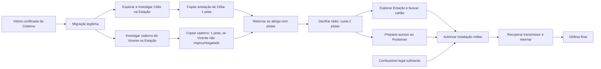

# Dependências narrativas de Última Transmissão

Status: mapa de requisitos do protótipo experimental em 2026-10-26. Não altera
`RULES.md`, `CAMPAIGN.md` nem o kit físico 0.2.

## Grafo atual

## Condições e autoridade

| Passo | Condição executável | Origem/estado |
|---|---|---|
| Cisterna → arco 2 | `verified_victory`, nenhum encontro ou expedição pendente | regra atual do migrador e replay seed 22 |
| Encontrar Célia | expedição contínua, Estação, antes do código, mover até zona 14, pagar 1 PA; zona sem inimigo | configuração experimental `data/regional_campaign.json` |
| Copiar evidência de Célia | investigação física anterior, mesma identidade/local, zona segura, 1 PA; +1 pista; ID único | experimental; uma ação não equivale a recrutamento |
| Recrutar Célia | contato físico em sua zona, 1 PA, transporte, sustento e alojamento | motor experimental; não concede pista |
| Vicente | Estação zona 12, somente se não constar como fundador/NPC migrado nem resgatado; pista física é +1 e única | origem de identidade `ZC-MOR-0003`; posição/evidência experimentais |
| Decifrar rádio | estar no abrigo, Cisterna verificada, pelo menos 2 pistas; consome 2 | `EXP-MIS-102` e API `Arc2.decode_radio` |
| Militar | rádio, cartão, van canônica e combustível conforme cálculo por segmentos | `EXP-MIS-104` experimental reconciliado para 12, ainda depende de economia/rota |

## Ciclo lógico removido; bloqueio físico permanece

Antes, a condição de Célia “após sinal de rádio” dependia de um rádio que
exigia pistas e de pesquisa que só Célia/Vicente podiam produzir. A alteração
experimental permite descobrir Célia antes do rádio sem conceder pista por
aparecer no mapa. A pista só entra após uma ação separada, em local seguro e
com recibo. A função de pesquisa de Célia é posterior e opcional.

Isso remove o ciclo lógico `rádio → Célia → pistas → rádio`, mas ainda não
torna a rota executável: Estação é `far=3`; ida 3 + início de rodada local 1 +
retorno 3 deixa no máximo 3 ativações locais no relógio de dez segmentos. O
caminho mais curto atual da entrada à zona 14 é `1–5–9–13–14`: 4 movimentos,
porta 1–5 (1 PA), porta bloqueada 13–14 (2 PA), investigação (1 PA) e cópia
da evidência (1 PA). O mesmo herói que atinge 14 precisa de 4 movimentos para
retornar a 1. Limite inferior: 13 PA individuais. Um herói dispõe de até 9 PA
em três ativações. Combate, hordas, ruído e demais objetivos só aumentam o
custo. O teste real seed 22 copia uma pista e falha na extração no relógio 7;
retirada de emergência mantém Célia no local e aplica suas consequências.

Possíveis alterações de design para revisão (nenhuma aplicada): (a) mudar a
localização da pista para um destino mais próximo, sem mudar os mapas; (b)
autorizar uma rota/atalho narrativo já representado por conexão, se existir
fonte canônica; (c) alterar a correspondência `far=3` ou a reserva/clock local.
Cada uma afeta dificuldade e precisa de decisão, teste e atualização de todas
as fontes. Não é possível afirmar a rota atual como solucionada.

## Ambiguidade de identidade

Vicente pode ser fundador/resgatado na origem. A migração preserva `rescue_history`;
o contato regional não é criado quando `ZC-MOR-0003` foi acolhido, nem se a
identidade já existe como fundador/NPC. Os dois IDs experimentais não são dois
Vicentes: `EXP-NPC-14` é a projeção condicional do mesmo `ZC-MOR-0003`.

## Limites de validação

O save JSON continua editável manualmente. Validadores conferem estrutura,
identidade, unicidade de ID, custo/recompensa e recibos de investigação prévios;
isso não é assinatura criptográfica. A prova de campanha atual não alcança
rádio, cartão, van, transmissor ou defesa final.
