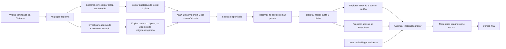

# Dependências narrativas de Última Transmissão

Status: mapa de requisitos do protótipo experimental em 2026-10-26. Não altera
`RULES.md`, `CAMPAIGN.md` nem o kit físico 0.2.

**Atualização de desbloqueio:** a investigação física pré-rádio de Célia e a
obtenção separada de evidências já estão implementadas como conteúdo
experimental; nenhuma pista vem do contato por si só. Isso remove o ciclo
lógico original, mas não resolve a disponibilidade condicional dos dois
autores de pista nem o contato/recrutamento da sobrevivente.

## Grafo atual

## Condições e autoridade

| Passo | Condição executável | Origem/estado |
|---|---|---|
| Cisterna → arco 2 | `verified_victory`, nenhum encontro ou expedição pendente | regra atual do migrador e replay seed 22 |
| Encontrar Célia | expedição contínua, Estação, antes do código, mover até zona 14, pagar 1 PA; zona sem inimigo | configuração experimental `data/regional_campaign.json` |
| Copiar evidência de Célia | investigação física anterior, mesma identidade/local, zona segura, 1 PA; +1 pista; ID único | experimental; uma ação não equivale a recrutamento |
| Recrutar Célia | contato físico em sua zona, 1 PA, transporte, sustento e alojamento | motor experimental; não concede pista |
| Vicente | Estação zona 12, somente se não constar como fundador/NPC migrado nem resgatado; pista física é +1 e única | origem de identidade `ZC-MOR-0003`; posição/evidência experimentais |
| Decifrar rádio | estar no abrigo, Cisterna verificada, pelo menos 2 pistas; consome 2 | `EXP-MIS-102` e API `Arc2.decode_radio` |
| Militar | rádio, cartão, van canônica e combustível conforme cálculo por segmentos | `EXP-MIS-104` experimental reconciliado para 12, ainda depende de economia/rota |

## Ciclo lógico removido; comparação de políticas e limite da prova

Antes, a condição de Célia “após sinal de rádio” dependia de um rádio que
exigia pistas e de pesquisa que só Célia/Vicente podiam produzir. A alteração
experimental permite descobrir Célia antes do rádio sem conceder pista por
aparecer no mapa. A pista só entra após uma ação separada, em local seguro e
com recibo. A função de pesquisa de Célia é posterior e opcional.

Isso remove o ciclo lógico `rádio → Célia → pistas → rádio`. A primeira rota
seed22 usava a política balanced, que gastava ações com combate opcional e
terminava em emergência no clock 7. A política `stealth`, que evita atacar
inimigos fora das zonas de objetivo/saída quando não bloqueiam o trajeto,
consegue investigar e copiar uma pista, eliminar ameaças apenas quando
necessário para objetivo/saída e retornar normalmente no segmento 10. A prova
continua parcial: só uma pista foi extraída; Célia não foi recrutada, o rádio
não abriu e isso não comprova equilíbrio nem campanha integral.

Possíveis alterações de design para revisão (nenhuma aplicada): (a) mudar a
localização da pista para um destino mais próximo, sem mudar os mapas; (b)
autorizar uma rota/atalho narrativo já representado por conexão, se existir
fonte canônica; (c) alterar a correspondência `far=3` ou a reserva/clock local.
Cada uma afeta dificuldade e precisa de decisão, teste e atualização de todas
as fontes. Não é possível afirmar a rota atual como solucionada.

## Ambiguidade de identidade

Vicente pode ser fundador/resgatado na origem. A migração preserva `rescue_history`;
o contato regional não é criado quando `ZC-MOR-0003` foi acolhido, nem se a
identidade já existe como fundador/NPC. Os dois IDs experimentais não são dois
Vicentes: `EXP-NPC-14` é a projeção condicional do mesmo `ZC-MOR-0003`.

## Disponibilidade real das duas pistas

O requisito do rádio é AND: duas pistas, não qualquer uma das fontes. O
catálogo regional só declara duas fontes experimentais, cada uma valendo uma
pista. `regional_contact_identity_available()` suprime Célia se ela já foi
escolhida como fundadora, e suprime Vicente se seu grupo foi acolhido na
Cisterna ou se a identidade já está presente. Nessas configurações, a
evidência disponível é no máximo uma; se ambas as condições ocorrerem, é zero.
O motor não tem outra fonte física conectada ao fluxo de campanha. Não
conceder pistas automáticas nem usar `campaign.py`/eventos isolados como
fallback: esses caminhos não fazem parte do replay regional legal.

O menor fechamento de conteúdo ainda depende de desenho: (a) separar as
anotações/cadernos físicos da presença dos sobreviventes e colocar evidência
explorável em local real; (b) permitir pesquisar Célia/Vicente já migrados por
uma ação explícita no abrigo; ou (c) adicionar uma terceira fonte física
limitada. Nenhuma opção foi aplicada nesta revisão.

## Limites de validação

O save JSON continua editável manualmente. Validadores conferem estrutura,
identidade, unicidade de ID, custo/recompensa e recibos de investigação prévios;
isso não é assinatura criptográfica. A prova de campanha atual não alcança
rádio, cartão, van, transmissor ou defesa final.
